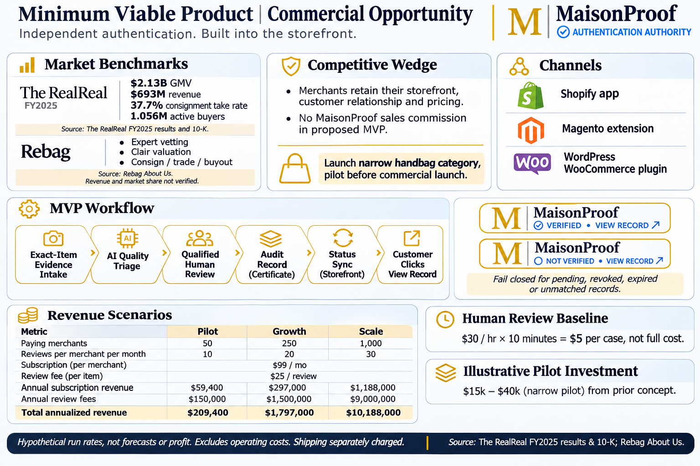
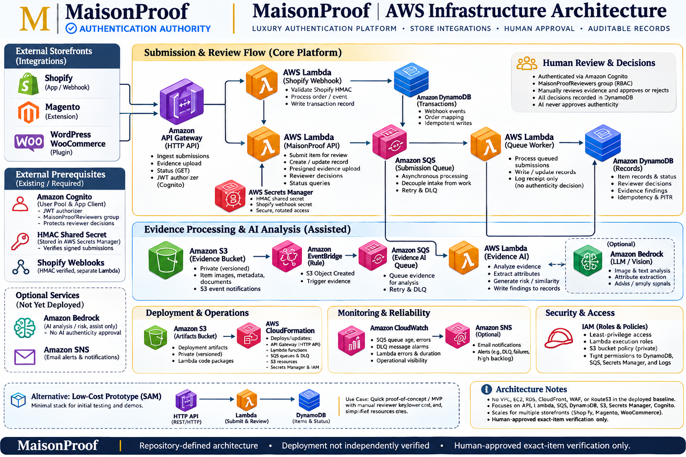
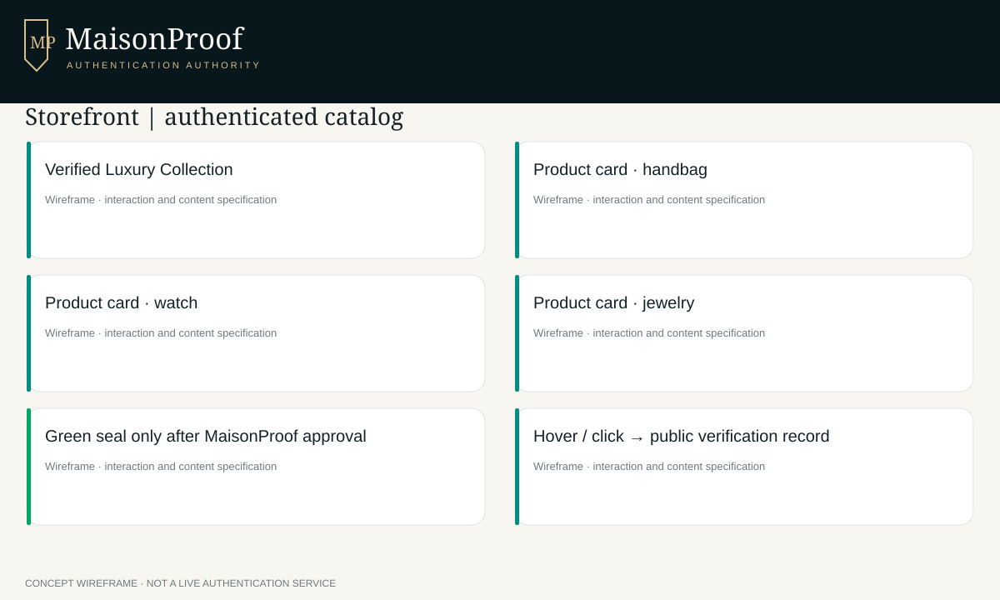
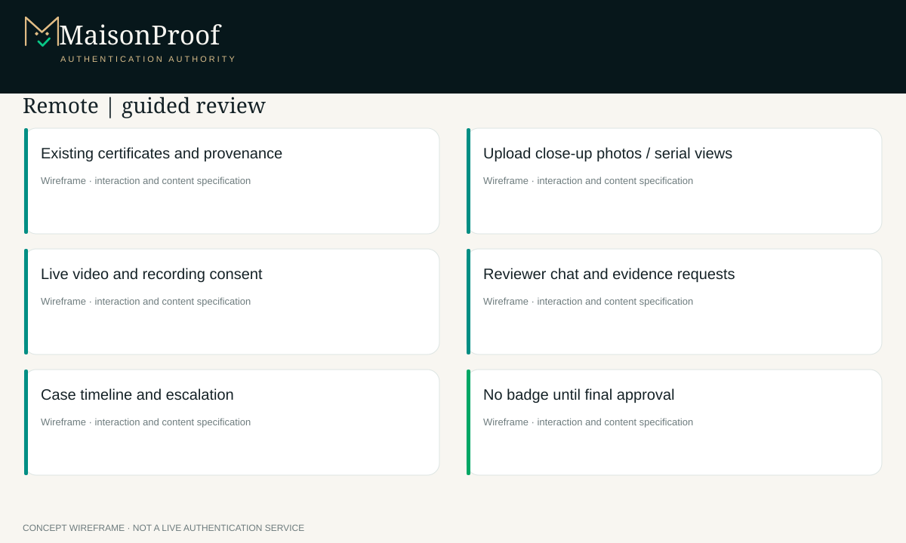
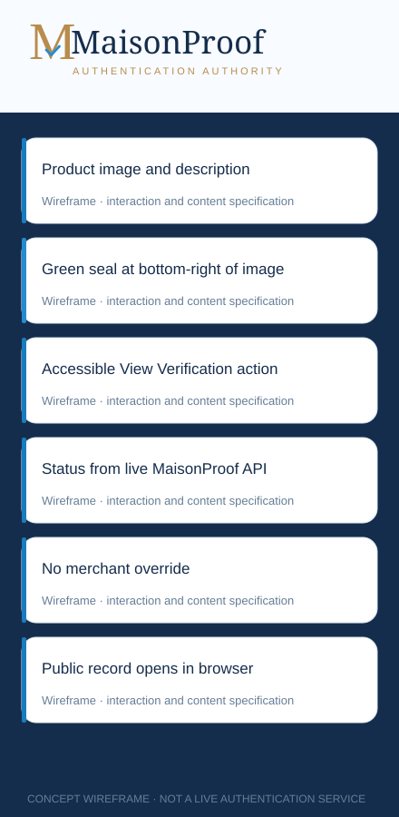
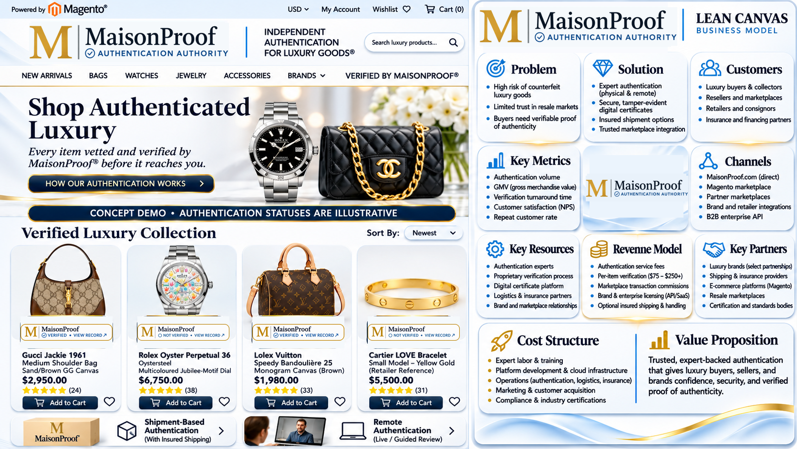

> **MaisonProof is the certifying authority for its own authentication seal.** Sellers submit products for MaisonProof review; the storefront badge activates only after MaisonProof approves that exact item. Installing a plugin or supplying outside documents cannot activate the seal.

# MaisonProof — Independent Luxury Authentication & Storefront Verification

**[Explore the interactive product prototype](https://blairyfairy.github.io/MaisonProof/prototype/index.html)** — navigable storefront, shipment and remote intake, reviewer workflow, public verification, merchant console, delivery roadmap, and the complete 12-image design gallery. Demo data only; no live authentication, insurance, or messaging integrations.

> **Design concept only.** The storefront, luxury products, brand references, shipping and insurance options, video consultation, certificate details, verification URL, dates, and green seals pictured above are illustrative mockups—not real authentication decisions, endorsements, manufacturer partnerships, or proof that these products were inspected. The pictured domain is not confirmed as owned or operational.

## MVP business model — Lean Canvas infographic

> **Illustrative business concept, not a financial forecast.** Prices, revenue scenarios, conversion lift, average order value, fraud reductions, and market-impact estimates shown in this graphic are hypotheses for testing—not validated operating results or guaranteed outcomes. Some figures in the concept illustration may be internally inconsistent; use independently modeled assumptions and verified data for investment decisions. The depicted authentication operations, integrations, and partner relationships are proposed, not established.

MaisonProof's proposed business model is to help independent merchants retain their own storefronts and transactions while purchasing item-level authentication services and optional platform subscriptions. It is **not** a resale marketplace. Actual merchant benefits must be measured against review fees, shipping and insurance costs, turnaround time, and customer trust outcomes.

## Competitive technology, AI authenticity roadmap, AWS spending and investment requirements (November 2026)

> **Status and evidence boundary.** This section is a forward-looking technical and commercial plan, **not** evidence that MaisonProof already authenticates luxury goods with AI or outperforms Entrupy, LegitApp, or another provider. The original repository is an MVP/scaffold. The subsequent three-platform/AWS enhancement packages provide additional integration and infrastructure foundations, but no live AWS deployment, complete Shopify OAuth lifecycle, independently validated counterfeit classifier, real authentication accuracy, or qualified production review operation is established by the materials inspected. Do not advertise accuracy, insurance coverage, brand partnerships, guaranteed turnaround, or production readiness without verification.

### 1. The actual competitive objective

Compete on **merchant ownership and multi-platform interoperability**, **evidence transparency**, **item-bound and revocable certificates**, **human-accountable decisions**, **fast guided capture**, and **measured low total cost per accepted case**. Entrupy's public process uses guided photography, brand/material selection, AI and expert review; it advertises 99.86% accuracy and a financial guarantee. These are **vendor claims**, not directly comparable to MaisonProof without a common blinded test set, matched category mix and decision policy. Source: [Entrupy's process and accuracy claims](https://www.entrupy.com/how-to-use/). Avoid implying that a generic multimodal LLM's description of an image proves authenticity.

**Required differentiated product:** a consistent MaisonProof-branded, accessibility-tested interface in Shopify, WooCommerce and Magento; two evidence routes (remote-guided and insured physical inspection, when operationally available); API-first case orchestration; seller-controlled catalog integration but MaisonProof-controlled decisions; transparent public verification and revocation; documented risk and evidence boundaries. Do not show a green authenticated badge for pending, inconclusive, disputed, revoked or unmatched items. Ensure item binding cannot be bypassed by a merchant editing a metafield.

### 2. Target system and feature gates

| Layer | AWS-first technology | Minimum completion requirement | Cost control |
|---|---|---|---|
| Merchant integrations | Shopify app + theme app extension; WooCommerce PHP plugin; Magento 2 module | Secure installation/uninstallation, per-shop credentials, catalog publish/update/delete hooks, idempotent webhooks, status synchronization, localized storefront badges, consent and error UX | One shared API, thin platform adapters |
| Edge/API | API Gateway HTTP API, Lambda, custom domain with ACM | Signature validation, short-lived credentials, rate limits, input schemas, replay protection, merchant isolation, safe public read APIs | HTTP API rather than REST API where features suffice |
| Case workflow | SQS + DLQ, Lambda, optional Step Functions Express | Durable workflow, retry/backoff, poison-message quarantine, case SLA timers, compensating actions, operator replay | Event-driven, avoid always-on workers |
| Evidence | S3 private/versioned, presigned multipart uploads, SHA-256, lifecycle rules | Virus/malware scanning, MIME/magic-byte checks, limits, immutable decision evidence, retention and deletion policy, explicit media consent | S3 lifecycle and tiered retention |
| Metadata and audit | DynamoDB on-demand, conditional writes, TTL for ephemeral data | Item and tenant keys, status history, immutable decision events, dual-control on sensitive changes, dispute trail | On-demand initially; evaluate provisioned later |
| Identity/security | Cognito for reviewers, Secrets Manager, KMS, CloudTrail, IAM | MFA, least privilege, credential rotation, per-merchant isolation, access logging, incident runbooks, encryption | Avoid unnecessary NAT gateways and idle VPC resources |
| AI quality triage | Bedrock vision-capable model (optional) | Detect missing views, blur, glare, occlusion, inconsistent metadata, unsupported categories; return reasons and recapture instructions | Invoke only on new/changed evidence; cache by content hash |
| Authenticity scoring | Curated labeled dataset + category-specific classifier on SageMaker (later) | Brand/category-specific out-of-distribution tests, calibrated thresholds, false-accept risk, explainable reviewer evidence | Train periodically; batch inference or scale-to-zero where supported |
| Expert review | Human reviewer queue and QA | Reviewer credentials, conflict-of-interest controls, second review for high-risk cases, blind audits, escalation to physical examination | AI triages routine completeness, not final authenticity |
| Certificates and trust | Signed JSON attestation, KMS-backed signing, verification URL, revocation registry | Public status, item binding, cryptographic verification, expiry and revalidation, no private evidence leakage | Small public response; cache safe read-only responses briefly |
| Reliability | CloudWatch alarms, SNS, backup/PITR, deployment pipelines | RTO/RPO targets, restore drills, DLQ alerts, security regression tests, rollback, SLO dashboards | Begin single region; multi-region only after business justification |

**Important security choices:** Shopify webhooks must validate Shopify's HMAC over the raw request body; Shopify app installation must use the current supported authorization/session-token approach. WooCommerce and Magento must sign outgoing requests with distinct merchant secrets and timestamps/nonces, and rotate credentials. Do not expose write credentials in themes, product HTML, or browser-side JavaScript. For public verification, a certificate signature is not enough: always check live revocation and item binding.

### 3. What must be built before claiming competitive parity

| Priority | Deliverable | Acceptance test / proof |
|---|---|---|
| P0 | Three installable integrations | Install, configure, publish, update, delete, uninstall, replay and failure-mode tests on live sandbox shops for all three platforms |
| P0 | Merchant isolation and identity | Cross-tenant negative tests, replay/HMAC tests, MFA, scoped credentials, key rotation, audit trails |
| P0 | Fail-closed badge and signed records | Green seal only for current, exact-item approved decisions; revoked/expired/unknown never display approval; public verification is accessible and accessible by keyboard |
| P0 | Evidence chain and reviewer workflow | Tamper-evident audit events, verified evidence hashes, consent/retention, decision authority, dispute and appeal path |
| P1 | Guided capture and completeness AI | Capture protocol by category, quality metrics, repeatability tests, explicit human handoff; model cannot self-certify |
| P1 | Reference corpus and labeling | Rights-cleared authentic/counterfeit samples, chain-of-custody labels, brand/style/era coverage, leakage-free train/test split |
| P1 | Independently measured classifier | Blind prospective evaluation, confusion matrices, FAR/FRR by brand/material/era, confidence calibration, unknown-item rejection, drift alarms |
| P1 | Operational review and insured shipment | Qualified reviewers, custody logs, vetted carrier/insurer agreements, pricing and exclusions, documented claims handling |
| P2 | Commercial proof | Paid pilot retention, verified turnaround, customer disputes, per-case gross margin, merchant conversion A/B test |
| P2 | Enterprise compliance | Pen test, threat model, incident response exercise, privacy impact assessment, vendor due diligence, independent audit as needed |

**Stop/go rule:** never auto-approve solely from a general-purpose vision model. Until an independently tested authenticity classifier and specialist operating process exist, use AI for **evidence quality triage and review assistance only**. No defensible percentage of competitor superiority can be claimed before controlled head-to-head measurement.

### 4. AWS spending: lean launch versus production

All dollar amounts below are **illustrative USD monthly planning allowances**, not AWS quotes, committed prices or guaranteed bills. Assume one US AWS region, one account/environment for pilot, usage-based serverless, no 24/7 GPU endpoint, no multi-region active-active, and excluding taxes, staff, outside services, payment processing and carrier/insurance costs. Actual prices vary by region, request size, retention, model, free-tier eligibility and service configurations. Use the [AWS Pricing Calculator](https://calculator.aws/) with actual assumptions before committing spend. Official pricing: [API Gateway](https://aws.amazon.com/api-gateway/pricing/), [Lambda](https://aws.amazon.com/lambda/pricing/), [S3](https://aws.amazon.com/s3/pricing/), [DynamoDB](https://aws.amazon.com/dynamodb/pricing/), [SQS](https://aws.amazon.com/sqs/pricing/), [Bedrock](https://aws.amazon.com/bedrock/pricing/), [CloudWatch](https://aws.amazon.com/cloudwatch/pricing/), [SageMaker](https://aws.amazon.com/sagemaker/pricing/).

| Cost scenario | Pilot: ~100 cases/month | Early production: ~1,000 cases/month | Growth: ~10,000 cases/month |
|---|---:|---:|---:|
| API, Lambda, queues, DynamoDB, storage, basic logs | $10–$60 | $40–$250 | $250–$1,500 |
| AI evidence triage (budget cap, optional) | $0–$30 | $20–$250 | $200–$2,000 |
| Security, secrets, monitoring, backups, domain and incident allowances | $15–$100 | $60–$350 | $250–$1,500 |
| **Indicative AWS subtotal** | **$25–$190** | **$120–$850** | **$700–$5,000** |
| Human review (example 15–45 minutes/case × $25–$60 loaded hourly) | $625–$4,500 | $6,250–$45,000 | $62,500–$450,000 |

The human-review row is a **scenario calculation**, not a supplier quote: 100 cases × 0.25 hours × $25 = $625; 100 × 0.75 hours × $60 = $4,500. It shows why review operations, image acquisition, claims exposure and model validation may dominate AWS hosting. At 1,000 cases/month, 30 minutes × $35/hour = **$17.50 review labor per case** before overhead, shipping or AI. A $25 retail review fee would leave only $7.50 before all other costs. These figures are for planning, not predictions.

**Suggested initial budget controls:** start with an AWS monthly budget alert at **$50**, an escalation alert at **$150**, and a review threshold at **$300** for a pilot. AWS Budgets alerts do not automatically stop spending. Set Bedrock request quotas, token/image limits, maximum uploaded evidence, SQS concurrency, Lambda reserved concurrency, log retention, S3 lifecycle, and per-tenant monthly case caps. Require approval before enabling high-cost inference, dedicated GPU endpoints, multi-region replication, provisioned concurrency, NAT gateways, or advanced WAF configurations. Some protective services have their own minimum or per-rule fees; do not omit them from a production estimate.

**Unit-economics worksheet (calculate per cohort):** `revenue/case – reviewer minutes × loaded hourly rate / 60 – model cost/case – evidence storage and API cost/case – payment fees – customer support – expected rework – shipping/insurance subsidy – expected dispute/guarantee loss`. Model the 50th, 90th and 99th percentile review duration. A guarantee must be actuarially and legally assessed, not copied from a competitor's marketing.

### 5. Investment ranges beyond AWS (illustrative planning, not quotes)

| Workstream | Lean pilot budget range | Why it matters |
|---|---:|---|
| Security, platform hardening and external testing | $5,000–$30,000 one-time | Prevent fraudulent approvals, breaches, cross-tenant leakage |
| Storefront engineering, compatibility QA and app reviews | $10,000–$60,000 one-time | Reliable installation and lifecycle behavior on all three platforms |
| Qualified authenticators and operating procedures | $5,000–$30,000 setup plus per-case labor | Real decision authority and consistent review quality |
| Rights-cleared reference imagery, acquisition and labeling | $10,000–$100,000+ | Defensible AI training and validation; may be far more for broad brand coverage |
| Category-specific ML experiments and blind evaluation | $15,000–$100,000+ | Measurable discrimination rather than plausible visual descriptions |
| Legal, privacy, shipping, insurance and dispute design | $5,000–$40,000+ | Claims, consent, retention, brand/IP and physical custody exposure |
| Initial merchant acquisition and usability research | $2,000–$25,000 | Find viable segments and verify willingness to pay |

These are **model-generated planning ranges**, not sourced market rates. A realistic lean differentiation strategy is to begin with **one product category and a small number of brands**, expert-assisted remote review, and a transparent no-decision state, then expand only after reference-data coverage and blinded accuracy justify it. Broad luxury authentication with strong guarantees is a substantially larger undertaking than deploying AWS services.

### 6. Best technical differentiators and decision criteria

1. **One verification authority, three commerce platforms:** consistent IDs, statuses, design tokens, and APIs; no seller-issued approvals.
2. **Risk-adaptive capture:** guided photo checklist changes by category, brand, material, condition and known failure modes; require physical examination where needed.
3. **Two-stage AI:** inexpensive image-quality/completeness model first; optional specialist authenticity model only on eligible, well-documented categories; human review for all consequential decisions until validated policy permits otherwise.
4. **Item-level evidence provenance:** hashes, capture timestamps, device/session metadata where consented, duplicate image detection, item matching, chain-of-custody events, and decision trace.
5. **Revocable signed certificate:** verifiable issuer key, canonical item reference, issuance/expiry, current status and reason-coded revocation; never promise counterfeit-proof QR/NFC.
6. **Open merchant API and portable status:** Shopify, WooCommerce, Magento, and future integrations can consume the same public status contract without exposing private documents.
7. **Trust and measured outcomes:** publish coverage limits, inconclusive rate, turnaround distribution, blinded error rates, dispute resolution and independent audits, rather than a fabricated headline accuracy figure.
8. **Cost-per-case discipline:** charge for expert review and optional shipment; avoid calling expensive models on every badge view; cache public non-sensitive reads with short TTL and revocation invalidation.

### 7. Technology alternatives — research only, not added dependencies

The **deployment target remains AWS-only**. Evaluate the following only if independent tests show measurable improvement: (a) specialist imaging devices or macro lenses for controlled capture; (b) accredited physical authenticators and independent labs; (c) legally licensed reference-image providers and manufacturer verification partnerships; (d) independent security and model-evaluation labs; (e) optional third-party messaging/video/insurance carriers where AWS-native services do not meet operational needs. These are **potential integrations**, not installed components or asserted partnerships. Any change requires vendor due diligence, a data processing agreement where relevant, privacy/security review, a documented fallback, and an explicit cost-benefit decision.

### 8. Implementation order, sprint alignment and release criteria

| Phase | Sprint alignment | Release gate |
|---|---|---|
| Foundations | 00–02 | Tenancy, API schemas, threat model, budgets, design tokens, public record policy |
| Commerce adapters | 03–05 | Shopify/WooCommerce/Magento sandbox lifecycle tests, webhook replay and idempotency, status consistency |
| Evidence and reviewer operations | 06–08 | S3 ingestion security, consent, auditability, reviewer decisions, guided capture, dispute flow |
| AI and trust | 09–10 | Quality triage metrics, licensed reference set, blind validation plan, certificate signing and revocation |
| Pilot and scale | 11–12 | Security assessment, recovery drills, usability testing, real merchant pilot, cost-per-case reporting, go/no-go |

**Required documentation cross-links:** [Architecture](https://blairyfairy.github.io/MaisonProof/project-management/viewer/ARCHITECTURE.html), [API contract](https://blairyfairy.github.io/MaisonProof/project-management/viewer/API_CONTRACT.html), [PRD](https://blairyfairy.github.io/MaisonProof/project-management/viewer/PRD.html), [Roadmap](https://blairyfairy.github.io/MaisonProof/project-management/viewer/ROADMAP.html), [Security and privacy](https://blairyfairy.github.io/MaisonProof/project-management/viewer/SECURITY_PRIVACY.html), [Authentication operations](https://blairyfairy.github.io/MaisonProof/project-management/viewer/AUTHENTICATION_OPERATIONS.html), [Test strategy](https://blairyfairy.github.io/MaisonProof/project-management/viewer/TEST_STRATEGY.html), [Release checklist](https://blairyfairy.github.io/MaisonProof/project-management/viewer/RELEASE_CHECKLIST.html), [Unit economics](https://blairyfairy.github.io/MaisonProof/project-management/viewer/UNIT_ECONOMICS.html), and [Sprints](https://blairyfairy.github.io/MaisonProof/project-management/viewer/SPRINTS.html).

**Launch decision:** release a *pilot review service* only after P0 security and merchant-status gates pass and a staffed decision process exists. Do not market *AI-authenticated products* until model accuracy is independently established for the exact supported categories, with false-acceptance controls, drift monitoring, expert escalation, and an audited certificate lifecycle. Re-evaluate infrastructure and costs monthly using actual AWS Cost Explorer data and per-case time tracking.

---

## The MaisonProof promise

**MaisonProof is the independent authentication authority behind the seal.** Merchants submit individual products to MaisonProof for assessment. MaisonProof reviews the item and available evidence using its own controlled authentication process, makes an item-specific decision, and issues an approval record only when its authentication requirements are met. **The green checkmark appears in the bottom-right corner of the product image only after the MaisonProof service confirms that the item has a current, valid MaisonProof approval.** Hovering or clicking the seal reveals a **View MaisonProof Verification** action that opens the item’s record on a verified MaisonProof-controlled domain.

The plugin is a display and status-check integration, **not a merchant-operated self-certification tool**. Sellers cannot activate a green authenticated seal by installing the plugin, entering a serial number, or uploading a receipt. Revoked, disputed, expired, unmatched, or unapproved records must not display the green authenticated state. The MaisonProof brand must operate a real, qualified review process before issuing genuine authentication approvals.

## Two ways to request MaisonProof authentication

MaisonProof offers **two review pathways**. Neither pathway grants automatic approval. A MaisonProof reviewer must evaluate the specific item and issue an item-bound approval before the storefront green checkmark activates.

### Option 1 — Shipment-based authentication (insurance options)

The merchant or owner requests a shipment-based authentication case and receives secure packing, labeling, tracking and insured-shipping instructions. Where available, the portal should offer **built-in shipping insurance or an approved third-party insurance option**, with clearly disclosed coverage limits, exclusions, deductibles, claims procedures and carrier requirements before payment or shipment. The item is sent to a MaisonProof-operated inspection facility or authorized receiving partner, with documented chain of custody, condition at intake, physical examination and return-shipping arrangements. A qualified MaisonProof reviewer issues the final item-specific decision. **No carrier, insurance provider, receiving facility, or coverage is currently integrated or guaranteed by this prototype.**

### Option 2 — Remote / guided authentication

The merchant or owner opens a secure MaisonProof case portal and submits existing authentication certificates, receipts, provenance, and detailed item photos. A MaisonProof reviewer checks the submitted materials and may request a **live video call, recorded item walkthrough, close-up photographs, serial or hallmark views, real-time chat, or follow-up correspondence**. Each request and response is retained in the case history with timestamps and reviewer identity. Existing third-party certificates are supporting evidence, **not automatic MaisonProof approval**. If remote evidence cannot establish confidence, the reviewer requests physical inspection or declines to authenticate.

### Shared approval and storefront activation

`Submitted → Identity/item intake → Shipment-based or remote evidence review → Additional requests as needed → MaisonProof decision → Signed item-specific record → Live storefront badge`

Only a current, approved MaisonProof decision for the exact product may trigger the **green checkmark at the bottom-right of its product image**. Clicking or hovering opens the MaisonProof-hosted verification page showing the decision, verification scope, date, record ID, review method, and non-sensitive audit summary. Pending, rejected, revoked, disputed, or inconclusive cases **do not display an authenticated green checkmark**.

**Design/implementation status:** The image illustrates the proposed user experience. Scheduling, video calls, recording consent and retention, chat, secure case correspondence, human review operations, and approval issuance require production implementation and staffing. The depicted certificates and approval statuses are fictional examples.

For the full case lifecycle, evidence-request correspondence, existing-certificate intake, video-consent rules, and badge eligibility, see [WORKFLOWS.md](WORKFLOWS.md). The starter includes an in-memory case state model in `api/cases.py` with tests, but does not yet provide a live portal.

## Storefront experience shown in the concept

- **Magento / Adobe Commerce product grid:** discreet green shield/checkmark at the **bottom-right of each approved product image**.
- **Hover / click:** “View MaisonProof Verification,” linking to an item-specific, MaisonProof-hosted record.
- **Authority page:** MaisonProof decision, item identifiers, review steps, date, status, and appropriately redacted evidence summary.
- **Live status:** the storefront must query the service and fail closed rather than display a stale or unverified approval.
- **Cross-platform ambition:** consistent behavior for Magento, WooCommerce/WordPress, Shopify, and a generic JavaScript embed.

**Current implementation:** This repository is an MVP/scaffold. The image is a target design, not a screenshot of a functioning Magento installation. The current platform integrations and API do not yet deliver the full depicted interactive hover experience, real-time secure approval lifecycle, or real-world product authentication. These features require further development and an operational authentication team.

An open-source MVP for MaisonProof-controlled authentication cases and a cross-commerce product verification badge. **This software does not authenticate goods on its own.** It models the MaisonProof final decision gate and displays a verification record. The MaisonProof seal activates only after **MaisonProof itself completes its authentication review and issues an approved, item-specific MaisonProof decision**. External authorities and documentation support MaisonProof’s assessment; they do not automatically authorize the badge.

## Platforms
- WooCommerce / WordPress: install `wordpress/maisonproof.php` as a plugin; configure verification base URL and product verification ID in product metadata `_maisonproof_id`.
- Shopify: paste `shopify/maisonproof-badge.liquid` into a theme snippet, render inside a product card/media container, and set `product.metafields.maisonproof.record_id`.
- Magento 2 / Adobe Commerce: initial module scaffold under `magento/MaisonProof/Verify`, with badge template and block; wire the block into the product media layout and populate the `maisonproof_record_id` product attribute.
- Other stores: use `embed/maisonproof.js` and set `data-maisonproof-id` on a product image wrapper.

## Public verification API
`python -m pip install -r api/requirements.txt && python -m uvicorn api.main:app --reload`

- `GET /v1/records/{id}` — structured evidence chain
- `GET /verify/{id}` — human-readable verification page
- `GET /health` — health check

The included JSON fixture is **DEMO ONLY** and contains no genuine verification. Production requires identity verification for issuers, controlled write endpoints, evidence storage, audit logging, signed attestations, revocation, and security review. Never expose buyer PII or unredacted invoices.

## Authoritative authentication decision process
MaisonProof is designed to **check whether an authentication claim is actually backed by an authorized, independently verifiable source**. A store installing the plugin cannot award itself an authenticated badge. The public record must show who authenticated the item, what authority that issuer has, how the exact item was matched, when checks occurred, and whether the assertion remains valid.

The required checks are: (1) bind evidence to the exact item; (2) verify issuer identity and the scope of its brand/category authority; (3) validate a signed attestation or issuer-controlled confirmation; (4) check revocation and dispute state; (5) detect duplicate identifiers and conflicting evidence; (6) record an auditable decision and recheck when necessary. Missing or inconclusive evidence must never silently become authenticated.

**Implementation boundary:** The included `api/authority.py` is a conservative *policy prototype* that only evaluates trusted-backend assertions. It does **not** perform live issuer lookups, cryptographic validation, independent physical inspection, or authoritative brand authentication. These require integrations, vetted authenticators and secure infrastructure before real-world authenticated claims can be made.

## Trust model
Evidence tiers: (1) direct brand/manufacturer verification via authorized integration; (2) named third-party authentication with issuer validation; (3) independently corroborated documents and ownership history; (4) unverified seller statements. Blockchain, QR codes, NFC tags, receipts and serial numbers are **supporting evidence only**, not automatic proof. No unauthorized brand logos, implied partnerships, or scraping restricted manufacturer databases.

## Domain and publishing
Suggested domain: `maisonproof.org` (not checked, registered, or controlled by this project). Configure your actual verified domain with `MAISONPROOF_BASE_URL`. Use HTTPS, DNS domain verification, a publicly published issuer registry, and cryptographic signing before offering commercial trust badges.

## Case workflow demonstration
`api/cases.py` models shipment-based and remote case intake, reviewer evidence requests, recorded-video consent, physical-inspection escalation and qualified MaisonProof decisions. It is **not exposed as a public case-write API** and cannot be used to issue real approvals. Run `python -m pytest -q` after installing `pytest`.

## Roadmap
1. Issuer onboarding + proof of authority, signed attestations and revocation endpoints.
2. Evidence upload with privacy controls, immutable audit log, and manual review queue.
3. Shopify app, WordPress plugin settings page, Magento admin attribute + layout integration.
4. QR/NFC verification with clone detection and anomaly monitoring.
5. Brand-authorized APIs and independent authenticator partnerships.

## License
MIT. No warranty of product authenticity.

## Project management, sprints and design handoff

A full [PM operating kit](https://blairyfairy.github.io/MaisonProof/#library) is included with a 13-sprint plan, 52 backlog items, risks, requirements, security/operations playbooks, UAT cases, design tokens, and 10 editable SVG wireframes for Figma import. This is a **planning package**, not evidence of completed implementation or live Figma integration. The two original visuals above remain unchanged.

## Visual experience and screen library

The visual inventory below includes **every image in this repository**: the two original branded concept images and all ten editable SVG wireframes. The concepts are illustrative, not evidence of an operating authentication service. The Lean Canvas numbers are unvalidated scenario assumptions. For an interactive, responsive overview, open [Project overview](https://blairyfairy.github.io/MaisonProof/index.html).

### 01 — Storefront & verification experience

Magento storefront concept, verified item seal, insured shipment and remote authentication routes.

### 02 — MVP Lean Canvas

Business model, customer segments, subscription and review-fee hypotheses, and illustrative impact scenarios.

### 03 — Authenticated storefront

Catalog, status, and approved-item badges

### 04 — Choose authentication route

Route selection between shipment and guided remote evidence

### 05 — Insured shipment intake

Shipment case intake, insurance options, custody requirements

### 06 — Guided remote review

Remote document, video, chat, and follow-up evidence

### 07 — Reviewer console

Reviewer queue and approval workflow

### 08 — Public verification record

Public item-specific approval, evidence summary, and status

### 09 — Merchant dashboard

Merchant case status and catalog integrations

### 10 — Trust operations

Review operations, disputes, and oversight

### 11 — Mobile product experience

Responsive product authentication badge

### 12 — Merchant analytics

Merchant analytics and conversion measurement

See the [delivery plan](https://blairyfairy.github.io/MaisonProof/project-management/viewer/SPRINTS.html), [product requirements](https://blairyfairy.github.io/MaisonProof/project-management/viewer/PRD.html), [design handoff](https://blairyfairy.github.io/MaisonProof/project-management/viewer/FIGMA_HANDOFF.html), and [project hub](https://blairyfairy.github.io/MaisonProof/#library).

## Competitive AI authentication — investment and operating model infographic

*Illustrative estimates, not vendor quotations, validated accuracy claims, or guarantees.* A narrow AI-assisted pilot is estimated at **$15,000–$40,000** in development spending, while broad multi-category competition could require **$150,000–$500,000+**. Illustrative AWS monthly budgets are **$25–$190 for 100 cases**, **$120–$850 for 1,000**, and **$700–$5,000 for 10,000**, excluding reviewer labor and major data acquisition. Trained reviewers are budgeted at **$20–$40/hour**, and senior specialists at **$40–$75+/hour**. At $30/hour, a 10-minute review costs approximately **$5** in direct labor. A solo operator could handle early volumes, but must account for escalations, customer support, security, and independent authenticity validation. AI triage is not proof of authenticity; signed certificates and verified claims require controlled decisions and audit evidence.

---

## Application atlas — screens, product imagery and implementation maps

This gallery documents the **current repository's prototype, illustrative product catalog, design assets, and planned architecture**. Visuals are concepts or demonstrations unless independently tested and documented. No displayed example is a MaisonProof authentication certificate.

**[Live homepage](https://blairyfairy.github.io/MaisonProof/)** · **[Interactive prototype](https://blairyfairy.github.io/MaisonProof/prototype/)** · **[Working documentation](https://blairyfairy.github.io/MaisonProof/#library)** · **[Source repository](https://github.com/blairyfairy/MaisonProof)**

### Product catalog — illustrative references, not authentication decisions

| Gucci Jackie 1961 | Rolex Oyster Perpetual 36 |
|:---:|:---:|
|  |  |
| Demonstration record only | Not verified |

| Louis Vuitton Speedy Bandoulière 25 | Cartier LOVE Bracelet Small |
|:---:|:---:|
|  |  |
| Demonstration record only | Not verified |

These images are **product references, not evidence of ownership, inspection, provenance, or authenticity**. Consult [image source and accuracy notes](assets/products/SOURCES_AND_ACCURACY.md) and the [product catalog](assets/products/catalog.json).

### Trust states and storefront presentation

### From merchant submission to authoritative approval

| Stage | Current design reference | Governing document |
|---|---|---|
| 1. Merchant initiates a case | [Route selection](project-management/design/wireframes/02-route-selection.svg) | [Product requirements](https://blairyfairy.github.io/MaisonProof/project-management/viewer/PRD.html) |
| 2. Shipment or remote evidence intake | [Shipment](project-management/design/wireframes/03-shipment.svg) / [Remote](project-management/design/wireframes/04-remote.svg) | [Authentication operations](https://blairyfairy.github.io/MaisonProof/project-management/viewer/AUTHENTICATION_OPERATIONS.html) |
| 3. Reviewer considers evidence | [Reviewer console](project-management/design/wireframes/05-reviewer.svg) | [Security and privacy](https://blairyfairy.github.io/MaisonProof/project-management/viewer/SECURITY_PRIVACY.html) |
| 4. Item-specific decision recorded | [Public record](project-management/design/wireframes/06-public-record.svg) | [API contract](https://blairyfairy.github.io/MaisonProof/project-management/viewer/API_CONTRACT.html) |
| 5. Approved badge syncs to merchant catalog | [Merchant dashboard](project-management/design/wireframes/07-merchant-dashboard.svg) | [Test strategy](https://blairyfairy.github.io/MaisonProof/project-management/viewer/TEST_STRATEGY.html) |

**Trust rule:** a plugin install, merchant claim, third-party paperwork, or AI score alone must never activate the MaisonProof verified seal. Approval requires a MaisonProof-controlled case decision and auditable evidence. The prototype illustrates this rule; it is not a live certification service.

### Platform architecture and integration surfaces

| Integration | Repository entry | Intended role |
|---|---|---|
| WooCommerce / WordPress | [`wordpress/`](wordpress/) | Product and order workflow, status display and API connectivity |
| Magento / Adobe Commerce | [`magento/`](magento/) | Storefront badge and merchant catalog integration |
| Shopify | [`shopify/`](shopify/) | Merchant installation and approved-state presentation |
| AWS backend | [`aws/`](aws/) | Evidence intake, case records, event processing, audit and decision services |
| Product prototype | [`prototype/`](prototype/) | Interactive experience for design and testing |
| Engineering documents | [`project-management/planning/`](project-management/planning/) | API, architecture, requirements and technical decisions |

These directories contain implementation work and design plans; **their presence does not establish production deployment, validated AI accuracy, operational insurance, or approved marketplace distribution**.

### Visual planning and sprint map

The repository includes 13 sprint-position diagrams (`SPRINT_00` through `SPRINT_12`) and visual summaries for planning, delivery, operations, quality, business, research, and design. The diagrams show **intended workflows**, not completion status.

Sprint 00 — visual workflow and detailed page

[MaisonProof sprint 00 planning and verification workflow](https://blairyfairy.github.io/MaisonProof/project-management/viewer/SPRINT_00.html)

[Open sprint 00 documentation](https://blairyfairy.github.io/MaisonProof/project-management/viewer/SPRINT_00.html)

Sprint 01 — visual workflow and detailed page

[MaisonProof sprint 01 planning and verification workflow](https://blairyfairy.github.io/MaisonProof/project-management/viewer/SPRINT_01.html)

[Open sprint 01 documentation](https://blairyfairy.github.io/MaisonProof/project-management/viewer/SPRINT_01.html)

Sprint 02 — visual workflow and detailed page

[MaisonProof sprint 02 planning and verification workflow](https://blairyfairy.github.io/MaisonProof/project-management/viewer/SPRINT_02.html)

[Open sprint 02 documentation](https://blairyfairy.github.io/MaisonProof/project-management/viewer/SPRINT_02.html)

Sprint 03 — visual workflow and detailed page

[MaisonProof sprint 03 planning and verification workflow](https://blairyfairy.github.io/MaisonProof/project-management/viewer/SPRINT_03.html)

[Open sprint 03 documentation](https://blairyfairy.github.io/MaisonProof/project-management/viewer/SPRINT_03.html)

Sprint 04 — visual workflow and detailed page

[MaisonProof sprint 04 planning and verification workflow](https://blairyfairy.github.io/MaisonProof/project-management/viewer/SPRINT_04.html)

[Open sprint 04 documentation](https://blairyfairy.github.io/MaisonProof/project-management/viewer/SPRINT_04.html)

Sprint 05 — visual workflow and detailed page

[MaisonProof sprint 05 planning and verification workflow](https://blairyfairy.github.io/MaisonProof/project-management/viewer/SPRINT_05.html)

[Open sprint 05 documentation](https://blairyfairy.github.io/MaisonProof/project-management/viewer/SPRINT_05.html)

Sprint 06 — visual workflow and detailed page

[MaisonProof sprint 06 planning and verification workflow](https://blairyfairy.github.io/MaisonProof/project-management/viewer/SPRINT_06.html)

[Open sprint 06 documentation](https://blairyfairy.github.io/MaisonProof/project-management/viewer/SPRINT_06.html)

Sprint 07 — visual workflow and detailed page

[MaisonProof sprint 07 planning and verification workflow](https://blairyfairy.github.io/MaisonProof/project-management/viewer/SPRINT_07.html)

[Open sprint 07 documentation](https://blairyfairy.github.io/MaisonProof/project-management/viewer/SPRINT_07.html)

Sprint 08 — visual workflow and detailed page

[MaisonProof sprint 08 planning and verification workflow](https://blairyfairy.github.io/MaisonProof/project-management/viewer/SPRINT_08.html)

[Open sprint 08 documentation](https://blairyfairy.github.io/MaisonProof/project-management/viewer/SPRINT_08.html)

Sprint 09 — visual workflow and detailed page

[MaisonProof sprint 09 planning and verification workflow](https://blairyfairy.github.io/MaisonProof/project-management/viewer/SPRINT_09.html)

[Open sprint 09 documentation](https://blairyfairy.github.io/MaisonProof/project-management/viewer/SPRINT_09.html)

Sprint 10 — visual workflow and detailed page

[MaisonProof sprint 10 planning and verification workflow](https://blairyfairy.github.io/MaisonProof/project-management/viewer/SPRINT_10.html)

[Open sprint 10 documentation](https://blairyfairy.github.io/MaisonProof/project-management/viewer/SPRINT_10.html)

Sprint 11 — visual workflow and detailed page

[MaisonProof sprint 11 planning and verification workflow](https://blairyfairy.github.io/MaisonProof/project-management/viewer/SPRINT_11.html)

[Open sprint 11 documentation](https://blairyfairy.github.io/MaisonProof/project-management/viewer/SPRINT_11.html)

Sprint 12 — visual workflow and detailed page

[MaisonProof sprint 12 planning and verification workflow](https://blairyfairy.github.io/MaisonProof/project-management/viewer/SPRINT_12.html)

[Open sprint 12 documentation](https://blairyfairy.github.io/MaisonProof/project-management/viewer/SPRINT_12.html)

Product requirements — visual workflow

[MaisonProof Product requirements workflow — open interactive HTML documentation](https://blairyfairy.github.io/MaisonProof/project-management/viewer/PRD.html)

[Open formatted product requirements page](https://blairyfairy.github.io/MaisonProof/project-management/viewer/PRD.html)

Architecture — visual workflow

[MaisonProof Architecture workflow — open interactive HTML documentation](https://blairyfairy.github.io/MaisonProof/project-management/viewer/ARCHITECTURE.html)

[Open formatted architecture page](https://blairyfairy.github.io/MaisonProof/project-management/viewer/ARCHITECTURE.html)

API contract — visual workflow

[MaisonProof API contract workflow — open interactive HTML documentation](https://blairyfairy.github.io/MaisonProof/project-management/viewer/API_CONTRACT.html)

[Open formatted api contract page](https://blairyfairy.github.io/MaisonProof/project-management/viewer/API_CONTRACT.html)

Analytics — visual workflow

[MaisonProof Analytics workflow — open interactive HTML documentation](https://blairyfairy.github.io/MaisonProof/project-management/viewer/ANALYTICS.html)

[Open formatted analytics page](https://blairyfairy.github.io/MaisonProof/project-management/viewer/ANALYTICS.html)

Sprint plan — visual workflow

[MaisonProof Sprint plan workflow — open interactive HTML documentation](https://blairyfairy.github.io/MaisonProof/project-management/viewer/SPRINTS.html)

[Open formatted sprint plan page](https://blairyfairy.github.io/MaisonProof/project-management/viewer/SPRINTS.html)

Authentication operations — visual workflow

[MaisonProof Authentication operations workflow — open interactive HTML documentation](https://blairyfairy.github.io/MaisonProof/project-management/viewer/AUTHENTICATION_OPERATIONS.html)

[Open formatted authentication operations page](https://blairyfairy.github.io/MaisonProof/project-management/viewer/AUTHENTICATION_OPERATIONS.html)

Security and privacy — visual workflow

[MaisonProof Security and privacy workflow — open interactive HTML documentation](https://blairyfairy.github.io/MaisonProof/project-management/viewer/SECURITY_PRIVACY.html)

[Open formatted security and privacy page](https://blairyfairy.github.io/MaisonProof/project-management/viewer/SECURITY_PRIVACY.html)

Test strategy — visual workflow

[MaisonProof Test strategy workflow — open interactive HTML documentation](https://blairyfairy.github.io/MaisonProof/project-management/viewer/TEST_STRATEGY.html)

[Open formatted test strategy page](https://blairyfairy.github.io/MaisonProof/project-management/viewer/TEST_STRATEGY.html)

Go-to-market — visual workflow

[MaisonProof Go-to-market workflow — open interactive HTML documentation](https://blairyfairy.github.io/MaisonProof/project-management/viewer/GO_TO_MARKET.html)

[Open formatted go-to-market page](https://blairyfairy.github.io/MaisonProof/project-management/viewer/GO_TO_MARKET.html)

Unit economics — visual workflow

[MaisonProof Unit economics workflow — open interactive HTML documentation](https://blairyfairy.github.io/MaisonProof/project-management/viewer/UNIT_ECONOMICS.html)

[Open formatted unit economics page](https://blairyfairy.github.io/MaisonProof/project-management/viewer/UNIT_ECONOMICS.html)

Research plan — visual workflow

[MaisonProof Research plan workflow — open interactive HTML documentation](https://blairyfairy.github.io/MaisonProof/project-management/viewer/RESEARCH_PLAN.html)

[Open formatted research plan page](https://blairyfairy.github.io/MaisonProof/project-management/viewer/RESEARCH_PLAN.html)

### Visual asset index

- [All ten product experience wireframes](https://blairyfairy.github.io/MaisonProof/project-management/viewer/FIGMA_HANDOFF.html) — storefront, route selection, shipping, remote evidence, reviewer, public record, merchant console, admin, mobile, analytics.
- [40 visual documentation pages](https://blairyfairy.github.io/MaisonProof/#library) — formatted technical and business reference pages.
- [Visual documentation library](https://blairyfairy.github.io/MaisonProof/#library) — open the formatted documentation pages.
- [AI investment infographic](https://blairyfairy.github.io/MaisonProof/assets/maisonproof-ai-competition-investment-infographic.png) — illustrative infrastructure and staffing ranges.
- [MVP Lean Canvas infographic](https://blairyfairy.github.io/MaisonProof/assets/maisonproof-mvp-lean-canvas-infographic.png) — illustrative business model and unit economics.
- [Product imagery and project documentation](https://blairyfairy.github.io/MaisonProof/#library) — demonstration references with status caveats.

### Readiness and verification boundaries

**Demonstrated in this repository:** source code, illustrative UI, documentation, workflow diagrams and integration scaffolding. **Requires separate validation before a commercial claim:** live deployment, security review, independent AI accuracy evaluation, production payment/insurance/shipping integrations, platform app approval, expert-review staffing and real item authentication. Consult the [release checklist](https://blairyfairy.github.io/MaisonProof/project-management/viewer/RELEASE_CHECKLIST.html) and [test strategy](https://blairyfairy.github.io/MaisonProof/project-management/viewer/TEST_STRATEGY.html) for evidence gates.
