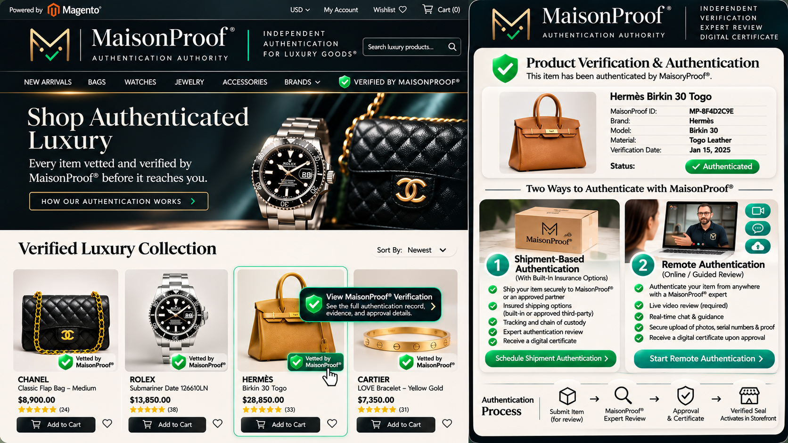
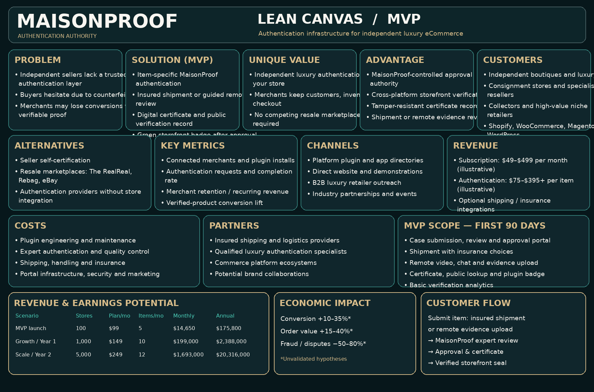
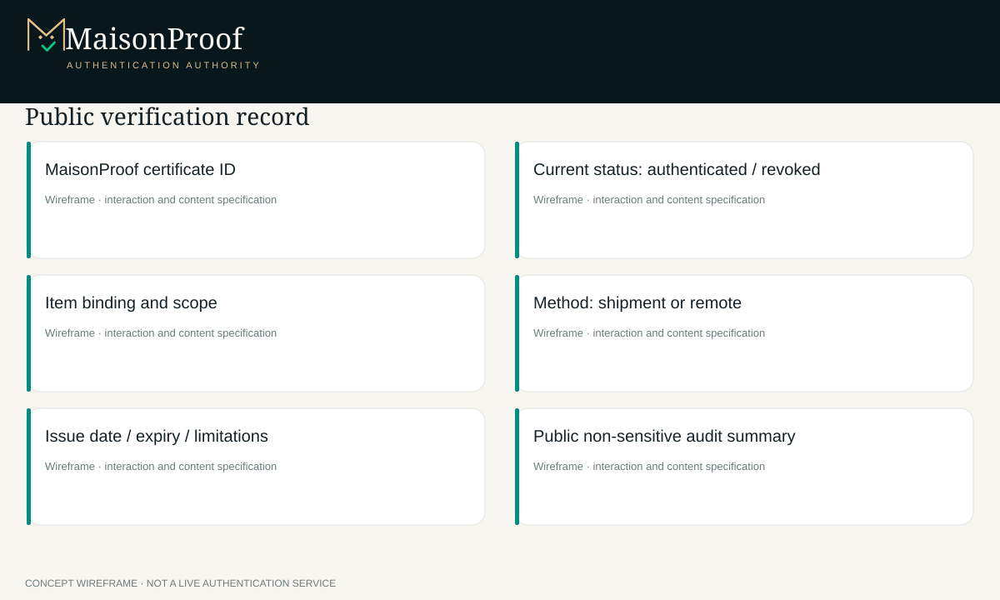
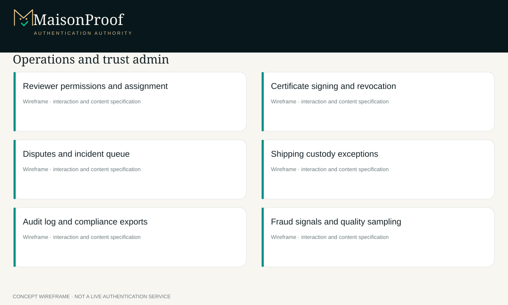
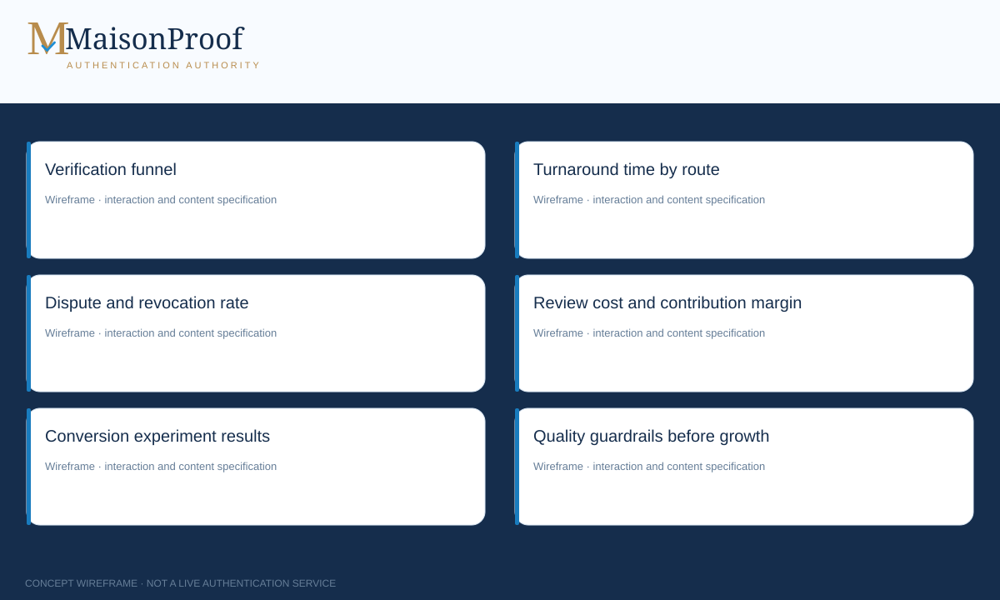

> **MaisonProof is the certifying authority for its own authentication seal.** Sellers submit products for MaisonProof review; the storefront badge activates only after MaisonProof approves that exact item. Installing a plugin or supplying outside documents cannot activate the seal.

# MaisonProof — Independent Luxury Authentication & Storefront Verification

> **Design concept only.** The storefront, luxury products, brand references, shipping and insurance options, video consultation, certificate details, verification URL, dates, and green seals pictured above are illustrative mockups—not real authentication decisions, endorsements, manufacturer partnerships, or proof that these products were inspected. The pictured domain is not confirmed as owned or operational.

## MVP business model — Lean Canvas infographic

> **Illustrative business concept, not a financial forecast.** Prices, revenue scenarios, conversion lift, average order value, fraud reductions, and market-impact estimates shown in this graphic are hypotheses for testing—not validated operating results or guaranteed outcomes. Some figures in the concept illustration may be internally inconsistent; use independently modeled assumptions and verified data for investment decisions. The depicted authentication operations, integrations, and partner relationships are proposed, not established.

MaisonProof's proposed business model is to help independent merchants retain their own storefronts and transactions while purchasing item-level authentication services and optional platform subscriptions. It is **not** a resale marketplace. Actual merchant benefits must be measured against review fees, shipping and insurance costs, turnaround time, and customer trust outcomes.

## The MaisonProof promise

**MaisonProof is the independent authentication authority behind the seal.** Merchants submit individual products to MaisonProof for assessment. MaisonProof reviews the item and available evidence using its own controlled authentication process, makes an item-specific decision, and issues an approval record only when its authentication requirements are met. **The green checkmark appears in the bottom-right corner of the product image only after the MaisonProof service confirms that the item has a current, valid MaisonProof approval.** Hovering or clicking the seal reveals a **View MaisonProof Verification** action that opens the item’s record on a verified MaisonProof-controlled domain.

The plugin is a display and status-check integration, **not a merchant-operated self-certification tool**. Sellers cannot activate a green authenticated seal by installing the plugin, entering a serial number, or uploading a receipt. Revoked, disputed, expired, unmatched, or unapproved records must not display the green authenticated state. The MaisonProof brand must operate a real, qualified review process before issuing genuine authentication approvals.

## Two ways to request MaisonProof authentication

MaisonProof offers **two review pathways**. Neither pathway grants automatic approval. A MaisonProof reviewer must evaluate the specific item and issue an item-bound approval before the storefront green checkmark activates.

### Option 1 — Shipment-based authentication (insurance options)

The merchant or owner requests a shipment-based authentication case and receives secure packing, labeling, tracking and insured-shipping instructions. Where available, the portal should offer **built-in shipping insurance or an approved third-party insurance option**, with clearly disclosed coverage limits, exclusions, deductibles, claims procedures and carrier requirements before payment or shipment. The item is sent to a MaisonProof-operated inspection facility or authorized receiving partner, with documented chain of custody, condition at intake, physical examination and return-shipping arrangements. A qualified MaisonProof reviewer issues the final item-specific decision. **No carrier, insurance provider, receiving facility, or coverage is currently integrated or guaranteed by this prototype.**

### Option 2 — Remote / guided authentication

The merchant or owner opens a secure MaisonProof case portal and submits existing authentication certificates, receipts, provenance, and detailed item photos. A MaisonProof reviewer checks the submitted materials and may request a **live video call, recorded item walkthrough, close-up photographs, serial or hallmark views, real-time chat, or follow-up correspondence**. Each request and response is retained in the case history with timestamps and reviewer identity. Existing third-party certificates are supporting evidence, **not automatic MaisonProof approval**. If remote evidence cannot establish confidence, the reviewer requests physical inspection or declines to authenticate.

### Shared approval and storefront activation

`Submitted → Identity/item intake → Shipment-based or remote evidence review → Additional requests as needed → MaisonProof decision → Signed item-specific record → Live storefront badge`

Only a current, approved MaisonProof decision for the exact product may trigger the **green checkmark at the bottom-right of its product image**. Clicking or hovering opens the MaisonProof-hosted verification page showing the decision, verification scope, date, record ID, review method, and non-sensitive audit summary. Pending, rejected, revoked, disputed, or inconclusive cases **do not display an authenticated green checkmark**.

**Design/implementation status:** The image illustrates the proposed user experience. Scheduling, video calls, recording consent and retention, chat, secure case correspondence, human review operations, and approval issuance require production implementation and staffing. The depicted certificates and approval statuses are fictional examples.

For the full case lifecycle, evidence-request correspondence, existing-certificate intake, video-consent rules, and badge eligibility, see [WORKFLOWS.md](WORKFLOWS.md). The starter includes an in-memory case state model in `api/cases.py` with tests, but does not yet provide a live portal.

## Storefront experience shown in the concept

- **Magento / Adobe Commerce product grid:** discreet green shield/checkmark at the **bottom-right of each approved product image**.
- **Hover / click:** “View MaisonProof Verification,” linking to an item-specific, MaisonProof-hosted record.
- **Authority page:** MaisonProof decision, item identifiers, review steps, date, status, and appropriately redacted evidence summary.
- **Live status:** the storefront must query the service and fail closed rather than display a stale or unverified approval.
- **Cross-platform ambition:** consistent behavior for Magento, WooCommerce/WordPress, Shopify, and a generic JavaScript embed.

**Current implementation:** This repository is an MVP/scaffold. The image is a target design, not a screenshot of a functioning Magento installation. The current platform integrations and API do not yet deliver the full depicted interactive hover experience, real-time secure approval lifecycle, or real-world product authentication. These features require further development and an operational authentication team.

An open-source MVP for MaisonProof-controlled authentication cases and a cross-commerce product verification badge. **This software does not authenticate goods on its own.** It models the MaisonProof final decision gate and displays a verification record. The MaisonProof seal activates only after **MaisonProof itself completes its authentication review and issues an approved, item-specific MaisonProof decision**. External authorities and documentation support MaisonProof’s assessment; they do not automatically authorize the badge.

## Platforms
- WooCommerce / WordPress: install `wordpress/maisonproof.php` as a plugin; configure verification base URL and product verification ID in product metadata `_maisonproof_id`.
- Shopify: paste `shopify/maisonproof-badge.liquid` into a theme snippet, render inside a product card/media container, and set `product.metafields.maisonproof.record_id`.
- Magento 2 / Adobe Commerce: initial module scaffold under `magento/MaisonProof/Verify`, with badge template and block; wire the block into the product media layout and populate the `maisonproof_record_id` product attribute.
- Other stores: use `embed/maisonproof.js` and set `data-maisonproof-id` on a product image wrapper.

## Public verification API
`python -m pip install -r api/requirements.txt && python -m uvicorn api.main:app --reload`

- `GET /v1/records/{id}` — structured evidence chain
- `GET /verify/{id}` — human-readable verification page
- `GET /health` — health check

The included JSON fixture is **DEMO ONLY** and contains no genuine verification. Production requires identity verification for issuers, controlled write endpoints, evidence storage, audit logging, signed attestations, revocation, and security review. Never expose buyer PII or unredacted invoices.

## Authoritative authentication decision process
MaisonProof is designed to **check whether an authentication claim is actually backed by an authorized, independently verifiable source**. A store installing the plugin cannot award itself an authenticated badge. The public record must show who authenticated the item, what authority that issuer has, how the exact item was matched, when checks occurred, and whether the assertion remains valid.

The required checks are: (1) bind evidence to the exact item; (2) verify issuer identity and the scope of its brand/category authority; (3) validate a signed attestation or issuer-controlled confirmation; (4) check revocation and dispute state; (5) detect duplicate identifiers and conflicting evidence; (6) record an auditable decision and recheck when necessary. Missing or inconclusive evidence must never silently become authenticated.

**Implementation boundary:** The included `api/authority.py` is a conservative *policy prototype* that only evaluates trusted-backend assertions. It does **not** perform live issuer lookups, cryptographic validation, independent physical inspection, or authoritative brand authentication. These require integrations, vetted authenticators and secure infrastructure before real-world authenticated claims can be made.

## Trust model
Evidence tiers: (1) direct brand/manufacturer verification via authorized integration; (2) named third-party authentication with issuer validation; (3) independently corroborated documents and ownership history; (4) unverified seller statements. Blockchain, QR codes, NFC tags, receipts and serial numbers are **supporting evidence only**, not automatic proof. No unauthorized brand logos, implied partnerships, or scraping restricted manufacturer databases.

## Domain and publishing
Suggested domain: `maisonproof.org` (not checked, registered, or controlled by this project). Configure your actual verified domain with `MAISONPROOF_BASE_URL`. Use HTTPS, DNS domain verification, a publicly published issuer registry, and cryptographic signing before offering commercial trust badges.

## Case workflow demonstration
`api/cases.py` models shipment-based and remote case intake, reviewer evidence requests, recorded-video consent, physical-inspection escalation and qualified MaisonProof decisions. It is **not exposed as a public case-write API** and cannot be used to issue real approvals. Run `python -m pytest -q` after installing `pytest`.

## Roadmap
1. Issuer onboarding + proof of authority, signed attestations and revocation endpoints.
2. Evidence upload with privacy controls, immutable audit log, and manual review queue.
3. Shopify app, WordPress plugin settings page, Magento admin attribute + layout integration.
4. QR/NFC verification with clone detection and anomaly monitoring.
5. Brand-authorized APIs and independent authenticator partnerships.

## License
MIT. No warranty of product authenticity.

## Project management, sprints and design handoff

A full [PM operating kit](project-management/README.md) is included with a 13-sprint plan, 52 backlog items, risks, requirements, security/operations playbooks, UAT cases, design tokens, and 10 editable SVG wireframes for Figma import. This is a **planning package**, not evidence of completed implementation or live Figma integration. The two original visuals above remain unchanged.

## Visual experience and screen library

The visual inventory below includes **every image in this repository**: the two original branded concept images and all ten editable SVG wireframes. The concepts are illustrative, not evidence of an operating authentication service. The Lean Canvas numbers are unvalidated scenario assumptions. For an interactive, responsive overview, open [Project overview](index.html).

### 01 — Storefront & verification experience

Magento storefront concept, verified item seal, insured shipment and remote authentication routes.

### 02 — MVP Lean Canvas

Business model, customer segments, subscription and review-fee hypotheses, and illustrative impact scenarios.

### 03 — Authenticated storefront

Catalog, status, and approved-item badges

### 04 — Choose authentication route

Route selection between shipment and guided remote evidence

### 05 — Insured shipment intake

Shipment case intake, insurance options, custody requirements

### 06 — Guided remote review

Remote document, video, chat, and follow-up evidence

### 07 — Reviewer console

Reviewer queue and approval workflow

### 08 — Public verification record

Public item-specific approval, evidence summary, and status

### 09 — Merchant dashboard

Merchant case status and catalog integrations

### 10 — Trust operations

Review operations, disputes, and oversight

### 11 — Mobile product experience

Responsive product authentication badge

### 12 — Merchant analytics

Merchant analytics and conversion measurement

See the [delivery plan](project-management/delivery/SPRINTS.md), [product requirements](project-management/planning/PRD.md), [design handoff](project-management/design/FIGMA_HANDOFF.md), and [project hub](project-management/README.md).
