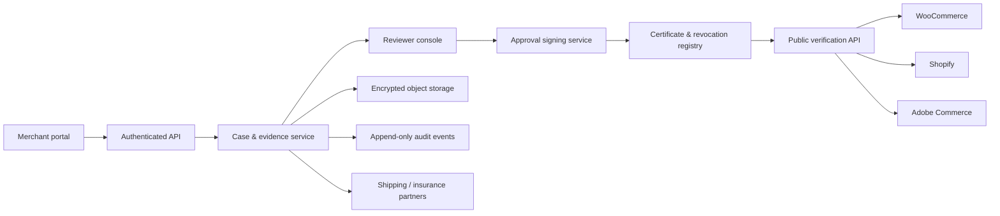

# Target architecture (not current code)

Trust boundaries: merchant JWT cannot call approval endpoints; reviewer decisions require separate role, audit and potentially dual approval; public responses redact personal data; verify signatures and item IDs server-side. Fail closed if status unavailable; never cache an authenticated response beyond revocation SLA. Shipping integrations are conditional on signed agreements.
