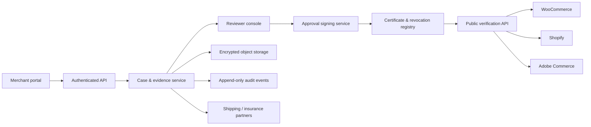

# Target architecture (not current code)

Trust boundaries: merchant JWT cannot call approval endpoints; reviewer decisions require separate role, audit and potentially dual approval; public responses redact personal data; verify signatures and item IDs server-side. Fail closed if status unavailable; never cache an authenticated response beyond revocation SLA. Shipping integrations are conditional on signed agreements.

## Current scenario implementation register — 2026-11-23

Status: Requirements and acceptance gates; not evidence of production completion.

- [ ] **ARCHITECTURE-01:** Diagram Shopify/WooCommerce/Magento adapters → API Gateway → Lambda → DynamoDB → SQS workers → private S3 evidence. Evidence: code location, automated test, staging trace, owner approval.
- [ ] **ARCHITECTURE-02:** Separate merchant identity, reviewer identity, and public read-only lookup permissions. Evidence: code location, automated test, staging trace, owner approval.
- [ ] **ARCHITECTURE-03:** Specify DLQs, replay, idempotency, per-tenant isolation, encryption, backup/PITR, alarms and audit. Evidence: code location, automated test, staging trace, owner approval.
- [ ] **ARCHITECTURE-04:** Bedrock is optional advisory evidence-quality analysis; authenticity requires trained validated domain models and expert review. Evidence: code location, automated test, staging trace, owner approval.
- [ ] **ARCHITECTURE-05:** Provide threat model and failure modes for duplicates, stale badges, revoked certificates and cross-tenant leakage. Evidence: code location, automated test, staging trace, owner approval.
- [ ] **ARCHITECTURE-06:** Product boundary and target merchant personas. Evidence: code location, automated test, staging trace, owner approval.
- [ ] **ARCHITECTURE-07:** Functional behavior and exception paths. Evidence: code location, automated test, staging trace, owner approval.
- [ ] **ARCHITECTURE-08:** Cross-platform event and status contracts. Evidence: code location, automated test, staging trace, owner approval.
- [ ] **ARCHITECTURE-09:** Evidence, AI triage and independent review. Evidence: code location, automated test, staging trace, owner approval.
- [ ] **ARCHITECTURE-10:** Nonfunctional SLOs, privacy and accessibility. Evidence: code location, automated test, staging trace, owner approval.
- [ ] **ARCHITECTURE-11:** Delivery milestones, owners and exit gates. Evidence: code location, automated test, staging trace, owner approval.

### Cross-platform release constraints

- Merchant-side apps cannot grant verified status; final decisions remain reviewer-authorized.
- AWS Bedrock image analysis is advisory and is not a validated counterfeit-authenticity classifier.
- Shopify OAuth/compliance webhooks, WooCommerce/Magento retries, tenant isolation, certificate signing, revocation and real-install tests remain release gates unless separately evidenced.
- All platform badges must resolve status against a server-authoritative record and handle pending, rejected, revoked and expired states safely.
